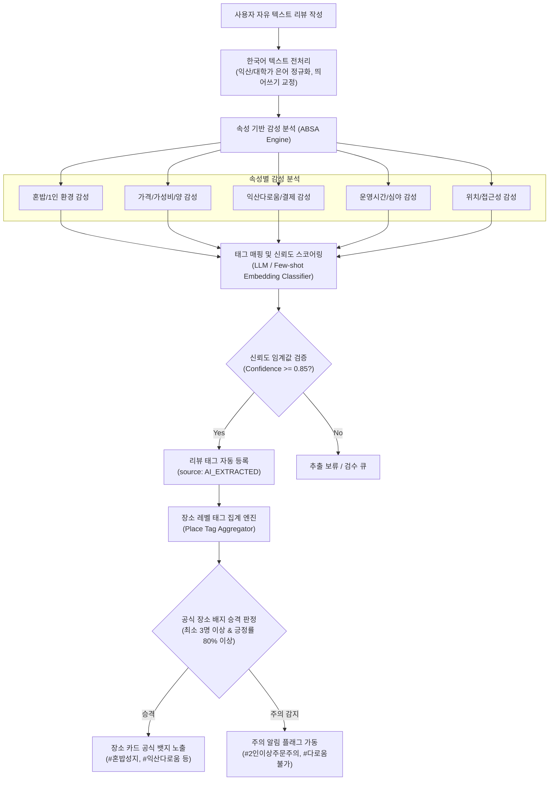

# 익산 1인 가구 및 원광대 대학생 특화 '로컬 라이프 & 편의 지도'
## 사용자 리뷰 & 평가 시스템 설계 사양서 (Evaluation System Architecture Specification)

---

## 1. 개요 및 배경 (Context & Objectives)

본 시스템은 전북특별자치도 익산시의 원광대학교 인근 원룸촌(신동 대학로, 북문, 후문 등) 및 영등동, 모현동 등에 거주하는 **자취 대학생 및 1인 가구**를 위한 특화 지도 서비스의 평가/리뷰 아키텍처입니다.

기존 대형 포털 지도(네이버, 카카오)가 제공하는 단순 별점 중심의 평가는 1인 가구가 실제로 겪는 페인 포인트(혼밥 가능 여부, 1인분 주문 제한, 익산다로움 카드 결제 여부, 심야 운영, 시험기간 운영, 원룸촌 골목 안전도 등)를 정확히 반영하지 못합니다. 본 사양서는 이러한 한계를 극복하고 신뢰성 높은 정량·정성 평가 데이터를 수집·가공·시각화하기 위한 종합 프레임워크를 정의합니다.

---

## 2. 세부 평가 프레임워크 및 키워드 태그 체계 (Evaluation Framework & Tag Taxonomy)

기본 5대 평가 지표(접근성, 운영 시간, 가성비, 1인 적합도, 편의성)를 기반으로 카테고리별(음식점/카페, 코인빨래방, 무인/편의시설, 스터디/작업공간 등) 맞춤형 세부 문항과 선택형 태그를 설계합니다.

### 2.1 5대 평가 지표 및 세부 하위 평가 항목

| 대분류 (Dimension) | 핵심 측정 목적 | 세부 평가 항목 (Sub-metrics) | 척도 (Scale) |
| :--- | :--- | :--- | :--- |
| **1. 접근성 (Accessibility)** | 원광대 캠퍼스 및 원룸촌 중심 보행 동선 친화도 | • 주요 거점(북문/대학로/정문/병원) 도보 이동 시간<br>• 심야 귀가로 조명 및 방범 상태 (골목 안심도)<br>• 자전거/전동 킥보드 접근 및 거치 용이성 | 5점 척도 + 보행 시간(분) |
| **2. 운영 시간 (Operating Hours)** | 불규칙한 대학생/1인 가구 생활 패턴 수용도 | • 심야/새벽 영업 여부 (22시 이후, 24시간)<br>• 주말/공휴일 정상 영업 여부<br>• 대학 시험기간 연장 운영 또는 방학 기간 단축 여부<br>• 브레이크 타임 유무 및 심야 포장/배달 가능 여부 | 불리언(Y/N) + 5점 척도 |
| **3. 가성비 (Cost Burden)** | 학생 및 청년 1인 가구 지갑 부담 완화도 | • 1인 기준 평균 식사/이용 단가 (1만 원 이하 여부)<br>• 음식 양(포션) 및 밥/반찬/음료 무료 리필 여부<br>• 세트 메뉴 구성의 실속도 (1인 세트)<br>• 원광대 학생증 제시 시 할인/서비스 제공 여부 | 5점 척도 + 평균 단가 입력 |
| **4. 1인 적합도 (Solo-Friendliness)** | 혼자 이용 시 심리적/물리적 마찰 제로도 | • 1인 좌석 구비 (바 테이블, 1인 칸막이, 1~2인 전용석)<br>• 1인분 주문 허용 여부 (고기구이, 찌개, 볶음류 등 2인 이상 강제 여부)<br>• 키오스크/비대면 셀프 주문 및 결제 환경<br>• 혼자 방문했을 때 직원/점포의 응대 편안함 (눈치 여부) | 5점 척도 (가중치 1.5x) |
| **5. 편의성 (Convenience & Facilities)** | 생활 편의 부가 시설 및 익산 특화 혜택 | • **익산다로움(지역화폐) 카드 가맹/캐시백 혜택 지원**<br>• 좌석별 콘센트 및 무선 인터넷(Wi-Fi) 품질<br>• 화장실 청결도 및 남녀 분리 여부<br>• 소포장/밀폐포장 상태 (1인 가구 잔반 방지)<br>• 대용량 세탁기/건조기 보유 대수 (빨래방) | 5점 척도 + 설비 체크리스트 |

---

### 2.2 표준 키워드 태그 사전 (Keyword Tag Taxonomy)

태그는 **긍정 배지(Positive Badges)**, **주의/비선호 배지(Caution Badges)**, **객관적 시설 속성(Attribute Badges)**으로 삼원화하여 사용자가 필터링 및 리뷰 작성 시 직관적으로 선택할 수 있도록 합니다.

```
[Tag Taxonomy Structure]
├── Positive Badges (장점/강력 추천)
│   ├── #혼밥최적 (Solo Dining Master)
│   ├── #1인석_칸막이 (Single Booth Available)
│   ├── #익산다로움_환영 (Iksan Daroum Accepted)
│   ├── #원광대_북문3분 (Near Wonkwang North Gate)
│   ├── #공깃밥_무한리필 (Free Rice Refill)
│   ├── #야식성지_새벽영업 (Open Late Night)
│   ├── #콘센트_자리마다 (Sockets at Every Seat)
│   └── #시험기간_24시간 (Exam Period 24/7)
├── Caution Badges (주의/필독 정보)
│   ├── #2인이상_주문필수 (Minimum 2-Person Order Required)
│   ├── #혼밥_눈치보임 (Uncomfortable for Solo Diners)
│   ├── #다로움_결제불가 (Daroum Not Accepted)
│   ├── #골목길_어두움 (Dim Alley at Night)
│   ├── #방학중_단축영업 (Shortened Hours during Vacation)
│   └── #주차불가_골목협소 (Narrow Alley No Parking)
└── Attribute Badges (객관적 정보/스펙)
    ├── #키오스크_선결제 (Kiosk Self-Ordering)
    ├── #남녀화장실_분리 (Separated Restrooms)
    ├── #1인포장_소용량 (Solo Takeout Portions)
    ├── #대용량건조기 (Heavy Duty Dryer)
    └── #반려동물_동반 (Pet Friendly)
```

#### 업종별 특화 서브 태그 매트릭스

| 업종 카테고리 | 핵심 태그 세트 (Selectable Tags) |
| :--- | :--- |
| **식당 (음식점/주점)** | `#혼밥석_보유`, `#1인분_가능`, `#고기1인_구이가능`, `#밥_반찬_무한리필`, `#익산다로움`, `#학생할인_5%`, `#음식이_빨리나옴`, `#브레이크타임_없음`, `#혼밥_눈치주의(Caution)` |
| **카페 & 스터디** | `#카공_환영`, `#전좌석_콘센트`, `#와이파이_초고속`, `#조용한_분위기`, `#새벽영업(02시)`, `#시험기간_밤샘가능`, `#넓은테이블`, `#노트북_타이핑존` |
| **코인빨래방 & 세탁** | `#24시간_무인`, `#이불빨래_가능(30kg+)`, `#운동화_전용세탁기`, `#다로움_결제기`, `#대기공간_쾌적`, `#동전교환기_완비`, `#분실물보관함` |
| **무인매장 / 편의점** | `#셀프계산대`, `#1인소포장_밀키트`, `#택배접수_픽업`, `#심야_안전출입(QR/인증)`, `#테이블_취식공간`, `#익산다로움_사용` |
| **헬스 / 피트니스** | `#1인샤워부스`, `#24시간_운영`, `#일일권_키오스크`, `#시험기간_정지혜택`, `#원광대생_제휴할인` |

---

## 3. 맞춤형 평점 & 리뷰 아키텍처 (Rating & Review Architecture)

### 3.1 4축 레이더 다차원 평점 모델 (Multi-dimensional Scoring Model)

단일 5점 만점 체계의 왜곡을 방지하기 위해, 사용자는 **종합 만족도**와 함께 1인 가구 핵심 가치를 반영한 **4대 세부 평점**을 부여합니다.

$$Score_{Composite} = w_1 \cdot S_{Solo} + w_2 \cdot S_{Cost} + w_3 \cdot S_{Access} + w_4 \cdot S_{Convenience}$$

* 권장 가중치: $w_{Solo}=0.35$, $w_{Cost}=0.25$, $w_{Access}=0.20$, $w_{Convenience}=0.20$ (1인 가구 특성상 혼자 이용 편의에 최고 가중치 부여)

1. **혼밥/혼자 편의 지수 ($S_{Solo}$)**: 눈치 보지 않고 당당히 이용할 수 있는가?
2. **가성비 지수 ($S_{Cost}$)**: 지출 금액 대비 만족도 및 양이 훌륭한가?
3. **동선/접근성 지수 ($S_{Access}$)**: 원광대 캠퍼스/원룸 밀집지에서 이동하기 편리한가?
4. **시설/결제 편의 지수 ($S_{Convenience}$)**: 다로움 카드, 콘센트, 화장실 등이 만족스러운가?

### 3.2 리뷰어 신뢰도 가중치 (Reviewer Credibility Tier)

허위 광고성 리뷰나 타지 방문객의 부적절한 평가를 필터링하기 위해 리뷰어 인증 상태에 따른 가중치를 부여합니다.

* **원광대 재학생 인증자 (`WONKWANG_VERIFIED`)**: 웹메일(@wku.ac.kr) 또는 학생증 모바일 인증 완료자 $\rightarrow$ **1.3배 가중치**
* **익산 로컬 자취생 인증자 (`IKASAN_RESIDENT_VERIFIED`)**: 익산시 거주지 GPS 인증 또는 공과금 고지서 인증자 $\rightarrow$ **1.2배 가중치**
* **일반 회원 (`GENERAL_USER`)**: 기본 가입자 $\rightarrow$ **1.0배 가중치**

---

### 3.3 장소 카드 (Place Card) UI/UX 시각적 구조도

모바일 웹 및 앱 화면에서 1인 가구가 스크롤 시 1초 만에 장소의 핵심 성격을 파악할 수 있도록 설계된 카드 레이아웃입니다.

```
+-----------------------------------------------------------------------+
| [음식점] 백두산 고기굽는밥집                   [♥ 342] [공유] [길찾기]   |
| 원광대 북문 도보 3분 (180m) · 원룸가 안심골목 길목                     |
+-----------------------------------------------------------------------+
|  종합 평점 ★ 4.7 (리뷰 89개)       [ 1인 특화 레이더 지수 ]             |
|                                    - 혼밥 편의 : ■■■■■ 4.9             |
|  [ 대표 뱃지 ]                     - 가 성 비 : ■■■■□ 4.8             |
|  [#혼밥최적] [#익산다로움]         - 접근 편의 : ■■■■■ 4.9             |
|  [#1인구이가능] [#밥무한리필]      - 시설 편의 : ■■■□□ 3.8             |
+-----------------------------------------------------------------------+
|  🕒 영업 상태 : 영업 중 (오늘 02:00 마감 / 야식 포장 가능)             |
|  💳 결제 혜택 : 익산다로움 결제 가능 (10% 즉시 페이백 매장)             |
|  👤 1인 환경  : 바 테이블 6석 완비 · 삼겹살 1인 반상 주문 가능         |
|  ⚡ 편의 시설 : 전 좌석 콘센트 완비 · Wi-Fi 5G 제공                    |
+-----------------------------------------------------------------------+
|  💬 원광대생 실시간 한줄평 (BEST):                                    |
|  "북문 자취 3년 차인데 삼겹살 혼자 먹고 싶을 때 여기만 옵니다.        |
|   1인 구이판에 구워져 나오고 된장찌개랑 공깃밥 리필 공짜라 갓성비예요"  |
+-----------------------------------------------------------------------+
```

---

## 4. 텍스트 리뷰 자동 분석 및 핵심 인사이트 태깅 파이프라인

사용자가 작성한 자유 텍스트 리뷰에서 감성과 세부 속성을 자동으로 추출하여 장소의 메타데이터로 승격시키는 인공지능/자연어 처리(NLP) 파이프라인입니다.



### 4.1 익산 로컬 맞춤 사전 및 전처리 정규화 (Domain Dictionary)
* **캠퍼스 거점**: `북문`, `남문`, `정문`, `후문`, `자대`, `의대`, `원대병원`, `대학로`, `신동사거리`, `원룸촌`, `씨즈퍼스트`
* **로컬 결제/문화**: `다로움`, `익산다로움`, `페이백`, `캐시백`, `공깃밥 무료`, `1인 반상`, `사근(사회과학대학 근처)`
* **부정 패턴 탐지**: `1인분은 안 판대요`, `혼자 왔다고 눈치 줌`, `다로움 카드 거절`, `밤에 가니 너무 어두움`

### 4.2 태그 승격 및 위험 경고 알고리즘 규칙

1. **공식 장소 태그 승격 규칙 (Badge Promotion Rule)**
   * 해당 장소의 리뷰 중 해당 태그 매핑 건수가 **최소 3건 이상**일 것.
   * 인증된 리뷰어(원광대생/익산시민)의 긍정 지지 비율이 **80% 이상**일 것.
   * 최근 6개월 이내의 리뷰 데이터에 시간 가중치(Decay factor: 0.95/월)를 적용하여 유지.

2. **부정/주의 플래그 즉각 경보 규칙 (Caution Trigger Rule)**
   * `#2인이상_주문필수` 또는 `#혼밥_눈치주의`, `#다로움_결제불가` 속성이 인증 회원 2명 이상에게서 연속 검출될 경우, 즉각 해당 장소 카드 상단에 노란색 주의 칩(Warning Chip) 부착.
   * 가맹점주 또는 사용자가 정정 리뷰를 등록하고 검증되면 자동 해제.
